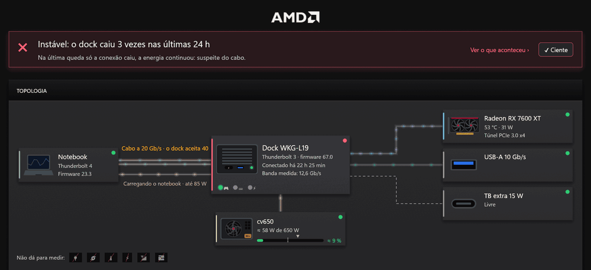
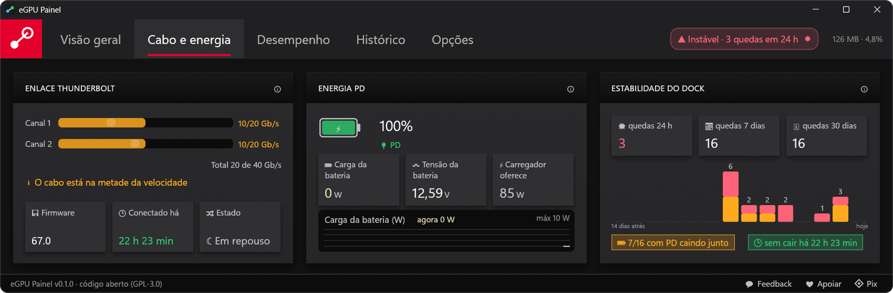
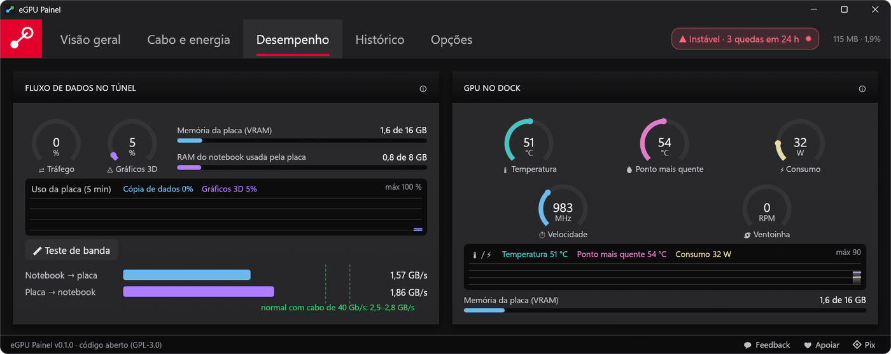
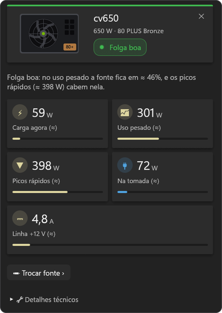
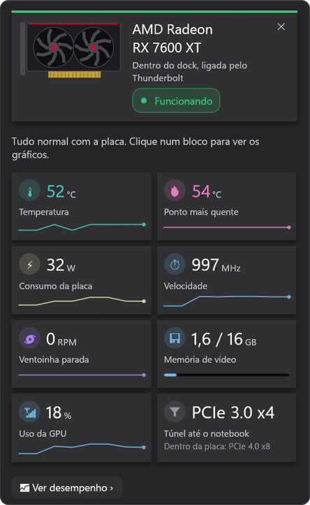
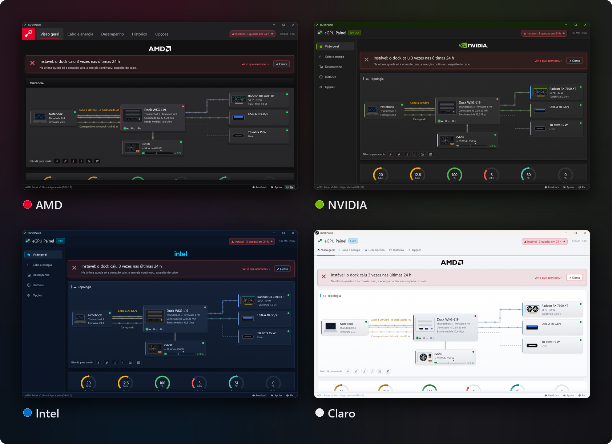
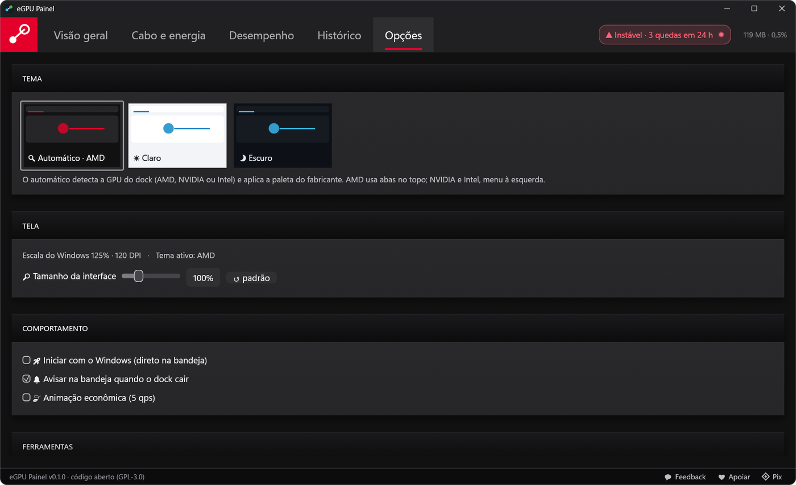
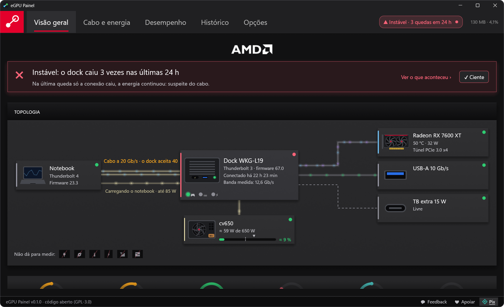

<h1 align="center">eGPU Painel</h1>

<p align="center">
  <b>Seu dock eGPU caiu? Veja o que caiu, quando e o provável porquê.</b><br>
  Monitor e diagnóstico para docks eGPU Thunderbolt 3/4 e USB4 no Windows.<br>
  <sub>Testado em WKG-L19 + RX 7600 XT · dados da GPU: só AMD por enquanto · por ora, só compilando do código-fonte · <a href="#funciona-com-o-meu">funciona com o meu?</a></sub>
</p>

<p align="center">
  <a href="LICENSE"></a>
  
  
  <a href="#apoie"></a>
</p>

<p align="center">
  <a href="docs/img/topologia.gif"></a><br>
  <sub>Gravação real: o dock caiu 3 vezes em 24 h, a energia continuou, só a conexão caiu, e o painel aponta o cabo. Os fios mostram o caminho notebook → dock → GPU ao vivo.</sub>
</p>

<p align="center">
  <a href="#funciona-com-o-meu">Funciona com o meu?</a> ·
  <a href="#destaques">Destaques</a> ·
  <a href="#instalação">Instalação</a> ·
  <a href="#uso">Uso</a> ·
  <a href="#por-dentro">Por dentro</a> ·
  <a href="#apoie">Apoie</a> ·
  <a href="#in-english">In English</a>
</p>

Seu dock eGPU cai no meio do jogo e o Windows só diz **"dispositivo removido"**. Foi o cabo? A fonte? A GPU? O **eGPU Painel** fica de olho no dock e, a cada queda, mostra **o que caiu, quando e a causa provável**, em português claro e com o histórico do que aconteceu antes.

Gratuito, código aberto e sem anúncios. Fica na bandeja usando ~2 MB de memória privada e 0% de CPU parado (medido no release; detalhes em [Por dentro](#por-dentro)), e não instala serviço do Windows nem driver. Só acessa a internet quando você pede (busca de specs da fonte).

> **Regra de projeto: não inventar dado.** Se o Windows não expõe um valor, o painel diz isso em vez de estimar escondido. Toda estimativa aparece rotulada como estimativa, e toda hipótese como hipótese.

## Por que existe

Começou como uma ferramenta para entender por que o meu próprio dock eGPU vivia caindo. O Windows até tinha as pistas, só que espalhadas entre o Gerenciador de Dispositivos, propriedades USB4 sem documentação e o Event Log. O eGPU Painel junta tudo isso numa tela só: nasceu num WKG-L19 com uma RX 7600 XT; as partes que não dependem do modelo do dock foram escritas para servir a outros docks Thunderbolt 3/4 e USB4, mas ainda não foram testadas neles (veja a tabela abaixo).

## Funciona com o meu?

Resposta honesta: foi construído e testado num único setup. O resto do mapa é este:

| | Setup | O que esperar |
|---|---|---|
| ✅ **Testado** | Dock WKG-L19 (Intel JHL7440 "Titan Ridge", Thunderbolt 3) + AMD Radeon RX 7600 XT, Windows 11 | Tudo funciona: foi aqui que o painel nasceu. |
| 🧪 **Deve funcionar, não testado** | Outros docks Thunderbolt 3/4 e USB4 | Topologia Thunderbolt/USB4 e PCIe, linha do tempo de quedas cruzada com o Event Log, energia PD e bateria, teste de banda D3D12 (vale para qualquer GPU D3D12) e calculadora da fonte não dependem do modelo do dock. A leitura das propriedades USB4 (velocidade das faixas e afins) foi calibrada no JHL7440 e vem com nível de confiança: em outro chip pode aparecer como "desconhecido". |
| 🧪 **Deve funcionar, não testado** | GPU NVIDIA ou Intel Arc no dock | A placa é achada pela posição atrás do switch PCIe do dock, não pelo fabricante (assim a iGPU Intel do notebook não é confundida), e o tema automático segue o fabricante. Essa lógica tem teste unitário com IDs de exemplo, mas nunca rodou com uma placa dessas. **NVIDIA:** temperatura, consumo, clock, uso e memória pelo NVML do driver (`nvml.dll`, carregada só se existir). **Intel:** só uso do motor 3D e memória, pelos contadores do Windows. O que a fonte não lê (ponto mais quente e ventoinha na NVIDIA; temperatura, consumo e clock na Intel) aparece como "não exposto". Na linha do tempo, eventos da placa ainda podem sair sem o rótulo de GPU. |

**Tem outro dock ou outra GPU?** Abra uma [issue](https://github.com/LightWolfMan/egpu-painel/issues/new?title=Compatibilidade:%20DOCK%20%2B%20GPU) (já vem com o título pronto, é só trocar DOCK e GPU) e conte o que apareceu, funcionando ou não. É assim que a lista de ✅ cresce.

> 💡 É só para Windows, e por enquanto não tem `.exe` pronto: precisa compilar (veja [Instalação](#instalação)) ou acompanhar o repositório para ser avisado do primeiro `.exe`. A interface é em português; a versão em inglês chega em breve.

## Destaques

🚦 **Saiba na hora se está tudo bem.** Um veredito só (*Tudo certo*, *Instável: caiu N vezes nas últimas 24 h* ou *Desconectado*) com a causa provável da última queda: energia caiu junto → fonte/tomada; só a conexão → cabo. Já viu o aviso? O botão **✔ Ciente** devolve o verde até surgir uma queda mais nova.

🔀 **Veja o caminho inteiro, do notebook à GPU.** Notebook, cabo, dock, GPU, portas e fonte num desenho animado, com pulsos que acompanham a atividade de cópia da GPU (o melhor sinal que o Windows dá do tráfego pelo túnel), a energia que o dock manda ao notebook em amarelo e um clique em qualquer nó para abrir os detalhes.

🔌 **Descubra se o culpado é o cabo ou a energia.** Velocidade e faixas do enlace USB4/Thunderbolt, energia PD (Power Delivery) e taxa de carga da bateria lidas pelo Windows, e quedas em 24 h, 7 e 30 dias, cada uma classificada como **"PD caiu junto"** (o dock inteiro apagou) ou **"só o enlace"**.

<p align="center">
  <a href="docs/img/cabo.png"></a>
</p>

🚀 **Confira se o enlace entrega o que promete.** Um teste de banda D3D12 sob demanda, nas duas direções e com qualquer GPU D3D12, ao lado de gauges de Copy e 3D, VRAM e memória compartilhada (a que atravessa o túnel).

<p align="center">
  <a href="docs/img/desempenho.png"></a>
</p>

⚡ **Saiba se a fonte do dock aguenta os picos.** Digite o modelo da fonte ATX, o painel busca as specs na internet (só quando você pede) e calcula ao vivo a carga, o pico transitório da placa e a corrente no +12 V, tudo rotulado como estimativa.

<p align="center">
  <a href="docs/img/painel-fonte.png"></a>
</p>

🎮 **Cada peça, em detalhe, num clique.** Selecione a GPU, o dock, o host, o cabo ou uma porta e o painel lateral mostra o que se sabe dela; na GPU AMD, via ADLX, isso inclui temperatura, hotspot, TBP, clocks, ventoinha e VRAM.

<p align="center">
  <a href="docs/img/painel-gpu.png"></a>
</p>

🎨 **Um visual que combina com a placa.** No automático, o painel lê o fabricante da GPU do dock e aplica a paleta e o layout dele (AMD com abas no topo, no molde do Adrenalin; NVIDIA e Intel com menu lateral), com claro e escuro à mão e vermelho reservado para problema real. Só o AMD foi visto com placa de verdade; NVIDIA e Intel podem ser vistos com `EGPU_TEMA=nvidia|intel` (veja [Uso](#uso)).

<p align="center">
  <a href="docs/img/temas.png"></a>
</p>

🪶 **Fica de olho sem pesar.** Fechou a janela, sobra só o ícone da bandeja: **~2 MB** de memória privada (3,7 MB de working set) e **0% de CPU**, sem polling, acordando só quando chega um evento; a janela é outro processo, que termina ao fechar e devolve toda a memória.

🕒 **Uma linha do tempo que não esquece.** Todo evento fica gravado num arquivo local que sobrevive a reinícios, e para cada queda o painel mostra os 2 minutos anteriores (ou avisa que foi sem aviso nenhum); exporta para CSV.

⚙️ **Do seu jeito.** Em Opções: tema, tamanho da interface, iniciar com o Windows, avisos na bandeja e animação econômica.

<p align="center">
  <a href="docs/img/opcoes.png"></a>
</p>

<p align="center">Achou útil? <a href="https://github.com/LightWolfMan/egpu-painel">⭐ Dê uma estrela</a>, que ajuda outros donos de eGPU a acharem o painel · <a href="#apoie">💜 Apoie</a></p>

## Instalação

Ainda não há `.exe` pronto para baixar: por enquanto, o caminho é compilar a partir do código-fonte.

Não quer compilar? Clique em **Watch → Custom → Releases**, no topo da página, e o GitHub te avisa quando sair o primeiro `.exe`.

Requer o Rust (edição 2024), que se instala pelo [rustup](https://rustup.rs). Com o toolchain **MSVC** (`stable-x86_64-pc-windows-msvc` e as Build Tools do Visual Studio), basta:

```
git clone https://github.com/LightWolfMan/egpu-painel
cd egpu-painel
cargo build --release
```

O binário sai em `target\release\egpu-painel.exe`. O perfil release usa `opt-level = 3`, LTO thin, `strip` e `panic = "abort"`.

Para instalar: copie `egpu-painel.exe` para uma pasta fixa (ex.: `%LOCALAPPDATA%\Programs\eGPU-Painel`), gere o ícone com `egpu-painel.exe --icone egpu.ico` e crie um atalho apontando para o exe com esse ícone. O exe é autossuficiente (logotipos e ícones embutidos).

<details>
<summary><b>Compilando com o toolchain GNU, sem MinGW e sem MSVC</b></summary>

<br>

Esta parte é só para o toolchain `stable-x86_64-pc-windows-gnu` **sem MinGW e sem MSVC instalados** (só o Rust self-contained). Ali há dois problemas, os dois resolvidos no `config.toml` do cargo do usuário, fora do repositório:

1. O `dlltool.exe` embutido falha com "CreateProcess" porque precisa do `as.exe`, que não vem no pacote. A saída é usar o do LLVM: `rustup component add llvm-tools`, copiar o `llvm-ar.exe` do componente para `%USERPROFILE%\.cargo\tools\llvm-dlltool.exe` e apontar `-Cdlltool` para ele.
2. O `ld` do GNU não entende os import libs gerados pelo LLVM, e o executável crasha com `0xC0000005` **antes do `main`** (Application Error 1000, módulo "unknown"). A evidência era o campo MajorLinkerVersion do exe marcando 2.44 (GNU ld) mesmo pedindo lld. Linkando com o `rust-lld`, o exe passa a ter MajorLinkerVersion 14 e roda.

Em `%USERPROFILE%\.cargo\config.toml` (o cargo aceita barras normais; troque `SEU_USUARIO` pelo seu perfil):

```toml
[target.x86_64-pc-windows-gnu]
linker = "C:/Users/SEU_USUARIO/.rustup/toolchains/stable-x86_64-pc-windows-gnu/lib/rustlib/x86_64-pc-windows-gnu/bin/rust-lld.exe"
rustflags = [
    "-Cdlltool=C:/Users/SEU_USUARIO/.cargo/tools/llvm-dlltool.exe",
    "-Clinker-flavor=ld.lld",
    "-Clink-self-contained=yes",
]
```

Depois, `cargo build --release`.

</details>

## Uso

```
egpu-painel.exe                bandeja + abre a janela
egpu-painel.exe --bandeja      inicia só na bandeja, sem abrir a janela
egpu-painel.exe --painel       só a janela (é o que a bandeja dispara)
egpu-painel.exe --bench        roda o teste de banda D3D12 e imprime no console
egpu-painel.exe --dump         imprime topologia e chaves USB4 decodificadas (dock e host)
egpu-painel.exe --perfil [N]   mede o custo de cada parte do coletor, sem janela
egpu-painel.exe --fonte "MODELO"  busca as specs de uma fonte e imprime o que achou
egpu-painel.exe --icone ARQ.ico   grava o ícone do painel (16/32/48/256 px), útil para atalhos
```

`--bench`, `--dump`, `--perfil` e `--fonte` se anexam ao console de quem chamou, então rode-os a partir de um terminal. Só uma instância roda por vez: abrir uma segunda pede à primeira que mostre a janela.

Variáveis para testes: `EGPU_TEMA=amd|nvidia|intel` simula a placa detectada (`claro|escuro` força o tema neutro); `EGPU_ABA=0..4` abre direto numa aba.

O painel só lê: não instala driver, não escreve no sistema além da chave de inicialização opcional e dos arquivos abaixo.

<details>
<summary><b>Onde ficam os dados</b></summary>

<br>

Tudo em `%LOCALAPPDATA%\eGPU-Painel\`:

| Arquivo | Conteúdo |
|---|---|
| `historico.jsonl` | linha do tempo, um evento JSON por linha, só acrescenta |
| `estado.json` | início da última varredura do Event Log e dispositivos já vistos atrás da USB-A |
| `config.json` | preferências (tema, zoom, avisos, modo econômico) e o reconhecimento do último aviso (Ciente) |
| `fonte.json` | modelo e specs da fonte do dock |
| `historico-AAAAMMDD-HHMMSS.csv` | exportações da linha do tempo (BOM, para o Excel abrir os acentos) |

</details>

<details>
<summary><b>A aba Opções</b></summary>

<br>

A aba **Opções** tem o tema (automático pela placa, claro ou escuro), a escala de DPI detectada e o tamanho da interface, e ainda:

- **Iniciar com o Windows (na bandeja):** grava um valor em `HKCU\Software\Microsoft\Windows\CurrentVersion\Run` apontando para `--bandeja`. Não precisa de administrador.
- **Avisar na bandeja quando o dock cair:** liga e desliga os balões.
- **Animação econômica (5 qps):** menos quadros por segundo na animação.
- **Exportar linha do tempo (CSV)**, **Abrir pasta de dados** e **Rodar teste de banda**.

</details>

## Por dentro

O dock eGPU é uma cadeia de coisas que o Windows enxerga em pedaços: um controlador USB4 no notebook, um roteador Thunderbolt no dock, um switch PCIe com três portas downstream (a GPU, o xHCI das portas USB-A e uma porta TB extra), e por trás disso uma fonte ATX e um controlador PD que o sistema operacional nem sabe que existem. O painel lê a topologia PnP, decodifica as propriedades USB4 do roteador, correlaciona os eventos do Event Log (PnP, energia, vídeo, WHEA, PCI) e guarda tudo numa linha do tempo persistente. Cada queda é classificada: o PD caiu junto (o dock inteiro apagou ou resetou) ou só o enlace caiu.

É um app nativo em Rust + egui: sem WebView, sem runtime e sem serviço do Windows, só o processo da bandeja e, quando aberta, a janela.

<details>
<summary><b>O que ele mostra, tela por tela</b></summary>

<br>

<p align="center">
  <a href="docs/img/geral.png"></a>
</p>

**Veredito no topo.** Uma frase só responde "meu dock está bem?": *Tudo certo*, *Instável: caiu N vezes nas últimas 24 h* ou *Desconectado*, com a causa provável da última queda (energia caiu junto → fonte/tomada; só a conexão → cabo). A pílula do cabeçalho segue a mesma cor. O botão **✔ Ciente** reconhece o aviso: o banner e a pílula voltam ao verde até surgir uma queda mais nova, e as quedas continuam no histórico. "Dock desconectado" não é reconhecível, porque é estado atual.

**Temas.** Claro e escuro são escolhidos à mão. No automático o painel detecta a GPU do dock pelo Vendor ID e aplica a paleta e o layout do fabricante: AMD com abas no topo no molde do Adrenalin, NVIDIA e Intel com menu lateral (AMD `VEN_1002`, NVIDIA `VEN_10DE` e Intel `VEN_8086`; a placa do dock é a que fica atrás do switch PCIe do dock, então a iGPU do notebook não conta; só AMD testado com placa real, os outros via `EGPU_TEMA`). O logotipo oficial aparece centralizado, como no HWiNFO. Vermelho fica reservado para problema real, e a cor de marca nunca pinta dado. A interface segue a escala de DPI do Windows e tem zoom próprio em Opções.

**Topologia animada.** Notebook, enlace, dock e GPU num desenho único. Os pulsos que correm pelo enlace usam a atividade do motor *Copy* da GPU como proxy do tráfego (são as cópias DMA host↔GPU, o que mais atravessa o túnel). A linha fina amarela representa a energia PD.

**Enlace USB4/Thunderbolt.** As propriedades `{5DF7E321-1C1B-4CE2-B4FA-55F4A5BC2CB6}` do roteador do dock e do host, decodificadas, cada uma com seu nível de confiança: *certo*, *forte*, *hipótese* ou *desconhecido* (veja a decodificação abaixo). Velocidade por faixa e número de faixas aparecem como visualização de lanes.

**Switch PCIe do dock.** Estado D0/D3 de cada uma das 3 portas downstream, o que está atrás de cada uma, firmware, e o enlace PCIe que o PnP reporta.

**PD e energia.** Energia externa sim/não, bateria carregando/descarregando e taxa em mW, lidas do driver de bateria ACPI (WMI `root\wmi`).

**Estabilidade.** Quedas em 24 h, 7 e 30 dias, gráfico de quedas por dia e a classificação de cada incidente: **"PD caiu junto"** (o note perdeu a energia externa no mesmo instante, o que aponta para o dock inteiro apagando) contra **"só o enlace"**. Mostra também há quanto tempo o dock está sem cair. Eventos a até 20 s um do outro entram no mesmo incidente, porque o switch e o roteador do dock saem com segundos de diferença.

**Fluxo de dados e teste de banda.** Gauges de Copy e 3D, VRAM dedicada e memória compartilhada (que atravessa o túnel) e um teste de banda D3D12 sob demanda: cópias na fila COPY entre heap de upload/readback do host e VRAM da GPU, 8 × 128 MiB por medição, nas duas direções. Nada fica residente depois do teste.

**Fonte do dock (estimativa em tempo real).** Você digita o modelo da fonte ATX e o painel busca as specs na web (potência, +12 V, selo 80 PLUS), só quando você pede, pelo `curl.exe` do Windows. Valor de +12 V só é aceito se for coerente com a potência; selo, só com duas ou mais citações ou quando o nome do modelo diz. Tudo pode ser corrigido à mão. Com isso, calcula ao vivo a carga (potência da placa medida pelo ADLX + notebook pelo PD, dock e portas estimados), a fração da fonte, o pico transitório possível da placa, o consumo na tomada pela eficiência do selo e a corrente no +12 V, e avisa se os picos podem desarmar a fonte (o que derruba o dock inteiro, PD junto).

**GPU via AMD ADLX.** Temperatura, hotspot, TBP, clocks, ventoinha e VRAM, pelo crate `adlx` (bindings pré-gerados, carrega `amdadlx64.dll` só com a janela aberta).

**Linha do tempo persistente e "o que veio antes".** Todos os eventos ficam num arquivo JSONL. Para cada queda, o painel mostra o que aconteceu nos 2 minutos anteriores, ou avisa que não havia nada no Event Log (queda sem aviso). Exporta para CSV.

</details>

<details>
<summary><b>O que o Windows não expõe</b></summary>

<br>

Alguns dados simplesmente não chegam ao sistema, e o painel não os fabrica. Eles aparecem numa faixa à parte, marcados como invisíveis.

- **Fonte ATX:** tensões, temperatura e potência real. A fonte não tem barramento de dados ligado ao dock; o cartão "Fonte do dock" mostra uma estimativa, rotulada como tal.
- **Ventoinha:** não há sensor de RPM ligado a um controlador visível pelo host.
- **Temperatura do JHL7440:** o Titan Ridge não publica sensor térmico ao Windows.
- **Contrato PD:** tensão e corrente negociadas ficam no controlador PD do dock; o Windows só vê "energia externa sim/não" e a taxa de carga.
- **Tráfego real:** não existe contador de bytes por adaptador USB4/TB. O motor Copy é um proxy, não uma medida.
- **Erros do enlace:** contadores de erro e retreino das faixas não são publicados. Só aparecem quedas (PnP) e erros PCIe (WHEA/AER).

</details>

<details>
<summary><b>Como funciona por baixo: bandeja, eventos e coleta</b></summary>

<br>

O objetivo é custar quase nada quando você não está olhando.

Com a janela fechada, o processo vive só na **bandeja**, em Win32 puro, bloqueado em `GetMessageW` sem timeout: zero polling, zero timers. O ícone é gerado em código (dois nós ligados, a cor do nó do dock indica o estado) e os balões de aviso saem dos callbacks de eventos.

Os eventos chegam por assinatura, nunca por varredura periódica: `EvtSubscribe` para o Event Log e `CM_Register_Notification` (todas as instâncias de dispositivo) para o PnP ao vivo. Na primeira execução há um backfill de 30 dias do Event Log; nas seguintes, só desde a última varredura. A deduplicação usa o canal e o número do registro.

A **coleta ao vivo** (ADLX, contadores PDH dos motores e da memória, WMI de bateria, releitura das propriedades PnP do dock) existe só enquanto a janela está aberta: uma thread, 1 amostra por segundo, parada ao fechar. Há também um modo de animação econômica (5 quadros por segundo) e o painel só repinta por evento ou por animação.

Fontes de eventos e IDs:

| Fonte | IDs / filtro | Vira |
|---|---|---|
| Kernel-PnP / Device Management | 1010 (removido), 1011 (removido inesperadamente, relatado como falhando) | queda do dock, GPU ou USB-A do dock |
| Kernel-Power | 105 (mudança de fonte, `AcOnline`), 42 (suspensão), 107 (retorno), 506/507 (espera moderna), 41 (reinício sem desligamento limpo) | PD perdido, suspensão, crash |
| Display | 4101 (driver de vídeo parou e se recuperou) | TDR real |
| Provedores `amdkmdag`, `amdwddmg`, `amduw23g` | níveis crítico, erro e aviso | erro do driver AMD |
| WHEA-Logger e Kernel-WHEA/Errors | todos | erro de hardware |
| PCI/Operational | níveis 1–3 e ID 2 (transição cancelada) | erro PCIe ou informativo |
| Kernel-General, EventLog | 12/13 (boot/desligamento), 6008 (desligamento inesperado) | contexto do sistema |
| Overwatch, `Settings_v0.ini` | `LastTDR` | "TDR relatado pelo jogo" |
| PnP ao vivo | chegada e saída de dispositivos | linha do tempo com estado capturado no instante |

Sobre o `LastTDR` do Overwatch: ele não é um TDR do Windows. É o jogo registrando que perdeu o dispositivo D3D, o que acontece tanto num TDR quanto quando a GPU some do barramento. Nos dados do autor não houve nenhum Display 4101 em 30 dias, apesar de várias quedas.

</details>

<details>
<summary><b>Decodificação empírica das chaves USB4 (e a chave 20)</b></summary>

<br>

O Windows publica propriedades USB4 do roteador sob o GUID `{5DF7E321-1C1B-4CE2-B4FA-55F4A5BC2CB6}`, sem documentação. A tabela abaixo foi montada comparando o dock com o host (valores de um dock WKG-L19 no host Intel Gen12) e é a base da função `decode_usb4`.

| pid | dock | host | leitura | confiança |
|---|---|---|---|---|
| 9 / 10 | Intel / Module 2 PD 85W | INTEL / Gen12 | fabricante e modelo do DROM | certo |
| 16 / 17 / 18 | 0x8086 / 0x15EF / 6 | 0x8087 / 0xA73E / 1 | VID / DID / REV do roteador (batem com os HardwareIds) | certo |
| 13 / 14 | 0x8086 / 0x0011 | 0x8087 / 0x463E | vendor e model ID do DROM | forte |
| 11 | `01 00 00 00 00 00 00` | zeros | route string: dock na porta 1 do host | forte |
| 15 | 1 | 0 | profundidade na árvore USB4 | forte |
| 8 | true | false | roteador TBT3 legado (só o dock tem CompatibleId TBT3) | forte |
| 20 | 0x8 | — | velocidade por faixa; no spec USB4 (Lane Adapter CS1) 0x8 = Gen2 10 Gb/s, 0x4 = Gen3 20 Gb/s | **hipótese** |
| 21 | 2 | — | faixas ativas | **hipótese** |
| 2, 12, 19, 22–24, 7 | 7, 0x4D0001, 16, 0, 2, 2 | 15, 0x4D0001, 32, 0, 0, 2, 0 | sem leitura conhecida | desconhecido |

### A chave 20 e o teste de banda

A chave 20 vale 0x8 no dock. Se ela é o campo "Current Link Speed" do spec USB4, isso significa 10 Gb/s por faixa; com 2 faixas (chave 21), o enlace estaria a **20 Gb/s**, e não a 40 Gb/s que o TB3 entrega.

O teste de banda D3D12 concorda. Medido na fila COPY, 4 × 1 GiB, estável:

| Direção | Medido | Esperado em TB3 a 40 Gb/s |
|---|---|---|
| host → GPU | 1,57–1,58 GB/s | 2,5–2,8 GB/s |
| GPU → host | 1,86 GB/s | 2,5–2,8 GB/s |

Os dois indícios apontam para o mesmo lado: o gargalo é o enlace (cabo ou negociação), não a GPU. Mas é uma hipótese consistente, não uma prova.

**O teste que prova:** trocar por um cabo TB3/TB4 de 40 Gb/s certificado (passivo e curto, até 0,8 m). Se a chave 20 passar a valer **0x4** e a banda subir para perto de 2,5 GB/s, a decodificação está confirmada. Se a chave não mudar, a hipótese cai e a chave volta para "desconhecido".

</details>

<details>
<summary><b>Consumo medido</b></summary>

<br>

Bandeja e janela são **processos separados**. A bandeja é mínima: fica bloqueada em `GetMessageW`, escuta o Event Log e o PnP por callback e é a única que grava o histórico. A janela (`--painel`) é um processo filho que lê o histórico, acompanha as linhas novas e **termina ao fechar**, devolvendo ao sistema toda a memória de egui, OpenGL e ADLX.

Medido no release, Windows 11, 12 threads lógicas:

| Estado | Working set | Privado | CPU |
|---|---|---|---|
| Bandeja | 3,7 MB | 2,2 MB | 0 ms em 30 s (0%) |
| Janela aberta (processo `--painel`) | ~120 MB | ~120–140 MB | ~19% de um núcleo (1,6% da máquina), quase tudo redesenho das animações a 15 qps |
| Janela fechada | o processo do painel deixa de existir | — | — |

O coletor em si (ADLX, PDH, WMI, topologia) custa ~2 ms de CPU por segundo (`--perfil`). Sem foco, ou no modo econômico, a janela redesenha a 5 qps.

</details>

## In English

<details open>
<summary><b>eGPU Painel in a nutshell</b></summary>

<br>

**Your eGPU dock dropped mid-game and Windows only says "device removed"?** Was it the cable, the power supply or the GPU? **eGPU Painel** is a free, open-source native Windows app (Rust + egui, no WebView, no Windows service, just a tray icon) that monitors Thunderbolt 3/4 and USB4 eGPU docks and, on every drop, shows what dropped, when, and the likely cause. It merges the PnP topology, the dock's undocumented USB4 router properties and the Event Log into a timeline that survives reboots, and tells you whether the whole dock lost power or just the link dropped.

It also shows lane speed, PD power state, a D3D12 bandwidth test (any D3D12 GPU), live GPU stats (AMD only for now) and an estimated load on the dock's ATX power supply. Its rule is to never make data up: what Windows doesn't expose is shown as unavailable. No ads; it only goes online when you ask it to (PSU spec search). The tray icon idles at ~2 MB of private memory and 0% CPU.

**Does it work with mine?** It started on the author's own setup and has been tested only there: a WKG-L19 dock (Intel JHL7440 "Titan Ridge", Thunderbolt 3) with an AMD Radeon RX 7600 XT on Windows 11. The topology, drop timeline, bandwidth test (any D3D12 GPU) and PSU calculator don't depend on the dock model and should work on other TB3/TB4/USB4 docks, but are untested there; USB4 property decoding was calibrated on the JHL7440 and carries confidence levels. NVIDIA and Intel Arc cards should work but are untested: the dock GPU is found by its position behind the dock's PCIe switch (so the laptop's Intel iGPU isn't mistaken for it), the auto theme follows the vendor, and that logic is unit-tested with sample IDs. NVIDIA data comes from the driver's NVML (temperature, power, clock, usage, memory); Intel shows only 3D-engine usage and memory from Windows counters. Anything the source doesn't read shows as "not exposed". Tried it on another dock or GPU? Please [open an issue](https://github.com/LightWolfMan/egpu-painel/issues/new?title=Compatibility:%20DOCK%20%2B%20GPU), whether it worked or not: that's how support grows.

Windows only. There's no prebuilt release yet: build it from source with `cargo build --release` (see [Instalação](#instalação)). The UI is in Brazilian Portuguese; an English UI is coming soon. Not a developer? Click **Watch → Custom → Releases** at the top of the repo page and GitHub will notify you when the first `.exe` ships. If it helped you, ⭐ star the repo.

</details>

## Apoie

O eGPU Painel é gratuito e vai continuar sendo: código aberto, sem anúncios e sem versão paga. Se ele te poupou uma noite caçando o motivo das quedas do seu dock, considere retribuir. O apoio vira tempo para seguir melhorando o painel, e a meta é usá-lo também para testar em outros docks e GPUs (NVIDIA e Intel incluídas).

O jeito mais valioso de ajudar nem é dinheiro: contar numa [issue](https://github.com/LightWolfMan/egpu-painel/issues/new?title=Compatibilidade:%20DOCK%20%2B%20GPU) como o painel se saiu no seu dock e na sua GPU (ou reportar um bug). Dar uma ⭐ no repositório e mostrar para quem também sofre com eGPU caindo ajuda do mesmo jeito.

Para apoiar com dinheiro, um café já ajuda, e qualquer valor conta:

- **Pix (Brasil):** escaneie o QR Code no app do banco ou use o *copia e cola*, com o valor que quiser.

<p align="center">
  
</p>

```
00020126580014br.gov.bcb.pix0136eec7ccba-5593-4f47-bf31-a9da4a3826a15204000053039865802BR5912LightWolfMan6006BRASIL62070503***6304A8C9
```

Chave aleatória: `eec7ccba-5593-4f47-bf31-a9da4a3826a1`

Só use o QR e a chave publicados aqui, no repositório original ([LightWolfMan/egpu-painel](https://github.com/LightWolfMan/egpu-painel)): uma cópia ou fork pode trocar os dois.

## Licença

Copyright (C) 2026 LightWolfMan. GPL-3.0 ou (a seu critério) qualquer versão posterior, sem nenhuma garantia; texto completo em [`LICENSE`](LICENSE). Em resumo: você pode usar, estudar, modificar e redistribuir à vontade; quem distribuir o programa, original ou modificado (inclusive só o `.exe`), precisa oferecer o código-fonte correspondente sob a mesma licença.

Os logotipos em `assets/logos/` (AMD, NVIDIA, Intel) vêm do Wikimedia Commons e são marcas registradas dos respectivos donos, **não** cobertos pela GPL. O painel os usa só para identificar o fabricante da placa detectada, como fazem ferramentas de diagnóstico.
